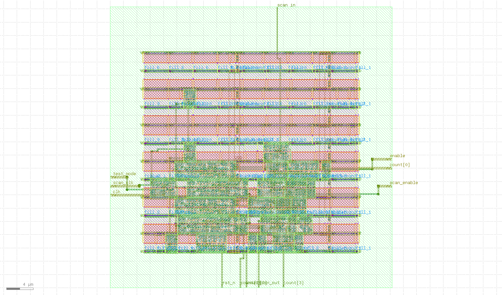
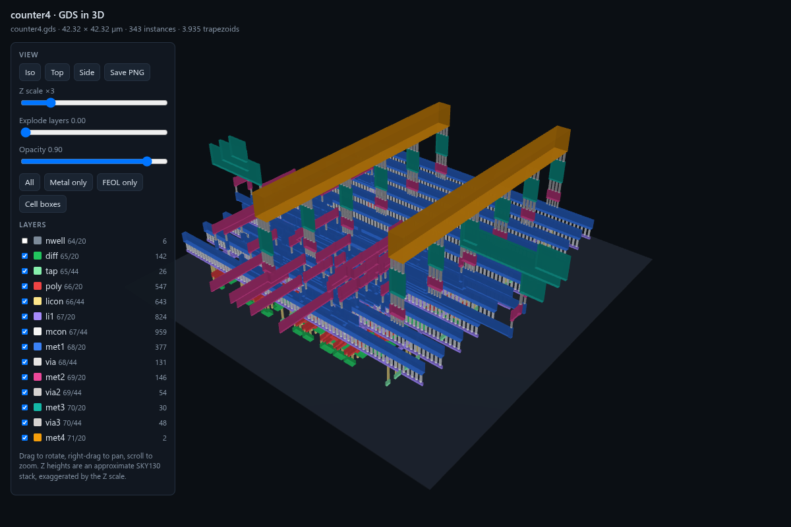
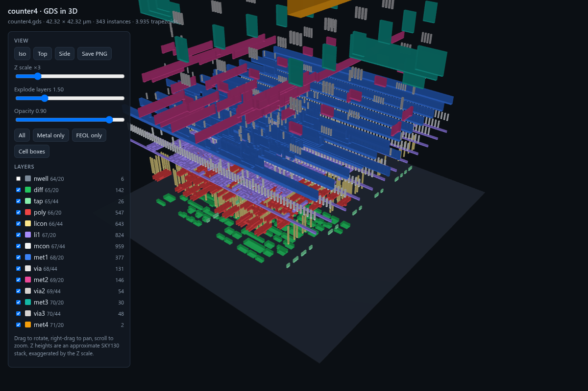

# ic-flow

A hands-on ASIC flow from a plain four-bit counter to a routed GDSII layout.
The six numbered directories contain the files used at each stage: functional
RTL, a Yosys synthesis script, Fault scan insertion, OpenROAD physical design,
GDS export, and signoff checks with a handoff package.

Scan logic is added by the DFT tools after synthesis. Physical design consumes
that generated scan netlist. The driver checks the imported netlist against
the DFT output before exporting layout.

## Run one stage at a time

From the repository root:

```sh
make -C example/01_rtl
make -C example/02_synthesis
make -C example/03_dft
make -C example/04_physical
make -C example/05_gds
make -C example/06_signoff
```

Each directory gets a `build/` link with its outputs and logs. The GDSII file is
`example/05_gds/build/counter4.gds`:



The same GDS in 3D ([view3d](example/06_signoff/view3d/README.md)), as drawn and with the layers pulled apart:




[docs/counter4_3d.html](docs/counter4_3d.html) is the interactive viewer. GitHub shows it as source;
download it and open it in a browser, or enable GitHub Pages on `/docs` to serve it.

The floorplan, placement, CTS and routing
databases are in `example/04_physical/build/`.

Run `make doctor` to check the installed environment, `make all` for the full
sequence, or `make test` for driver regressions. The default paths use the
existing local tools; see [configuration](example/scripts/README.md).

## Source layout

| Path | Work performed |
| --- | --- |
| [`01_rtl`](example/01_rtl/README.md) | Specify, implement and simulate a normal counter |
| [`02_synthesis`](example/02_synthesis/README.md) | Map RTL to SKY130HD cells with Yosys |
| [`03_dft`](example/03_dft/README.md) | Insert scan with Fault, test it and run ATPG |
| [`04_physical`](example/04_physical/README.md) | Floorplan, placement, CTS and routing |
| [`05_gds`](example/05_gds/README.md) | Write the GDS from the routed DEF and the cell layouts |
| [`06_signoff`](example/06_signoff/README.md) | KLayout and Magic DRC, KLayout and netgen LVS, antenna, post-route simulation, LEC, multi-corner STA, handoff, [3D viewer](example/06_signoff/view3d/README.md) |

See the [walkthrough](example/README.md), [reference results](example/REF_RESULT.md),
[background](#background-asic-and-fpga-flows) or [Vietnamese background](README_VI.md).

## Background: ASIC and FPGA flows

An ASIC flow produces a physical layout for a manufacturing process. An FPGA
flow maps a design onto a device that already contains programmable logic and
routing. Both start with RTL, constraints and functional verification.

This repository implements the ASIC path through a
[four-bit counter example](example/README.md).

### ASIC flow overview

| Stage | Purpose | Typical output |
| --- | --- | --- |
| RTL simulation | Check specified behavior with a testbench | Log, waveform |
| Synthesis | Map RTL to standard cells | Gate-level netlist |
| DFT and ATPG | Provide test access and generate defect-detection patterns | Scan logic, test patterns |
| Floorplan | Define the core, rows, pins and power grid | ODB, DEF |
| Placement | Assign cell positions | Placed database |
| CTS | Build the clock distribution network | Clock-tree database |
| Routing | Connect pins using metal and vias | Routed database, DEF |
| RC extraction and STA | Analyze timing with wire parasitics | SPEF, timing reports |
| Layout export | Assemble cell and routing geometry | GDSII or OASIS |
| Physical checks | Check geometry and extracted connectivity | DRC and LVS reports |

The example starts with functional-only RTL. Fault inserts scan after synthesis
and cuts the scan flip-flops for ATPG. OpenROAD uses the generated scan netlist
with its flip-flops intact.

### FPGA flow

FPGA synthesis maps RTL to LUTs, registers, memories and other device resources.
Placement and routing select physical sites and programmable connections.
Bitstream generation produces the configuration loaded onto the device.

A LUT implements a Boolean truth table; an N-input LUT needs 2^N truth-table
bits. In SRAM-based FPGAs, these configuration bits are held in SRAM. Registers
store clocked state. Some LUTs also support distributed RAM or shift-register
modes, depending on the device.

### Reading verification results

Simulation checks the behavior exercised by the testbench. Equivalence checking
compares two circuit representations under stated assumptions. Static timing
analysis checks constrained paths without applying functional test vectors.
Gate-level simulation includes delays only when suitable delay data, such as
SDF, is applied.

DRC checks the rules enabled in its deck. LVS compares extracted connectivity
with a reference. A passing result applies to that deck, model and reference.
The example's [signoff guide](example/06_signoff/README.md) records its limits.

## License

[MIT](LICENSE). Physical design reuses OpenROAD Flow Scripts; compatibility
code is adapted from [tcl-train](https://github.com/quannguyen247/tcl-train).
